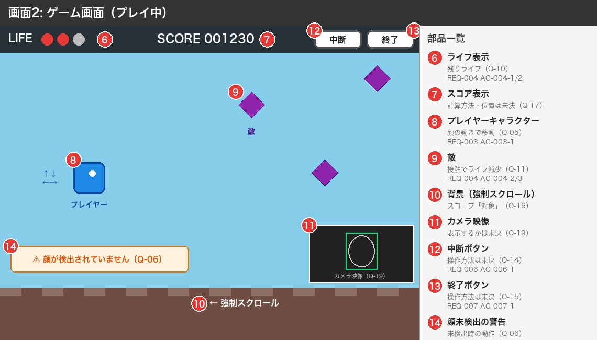
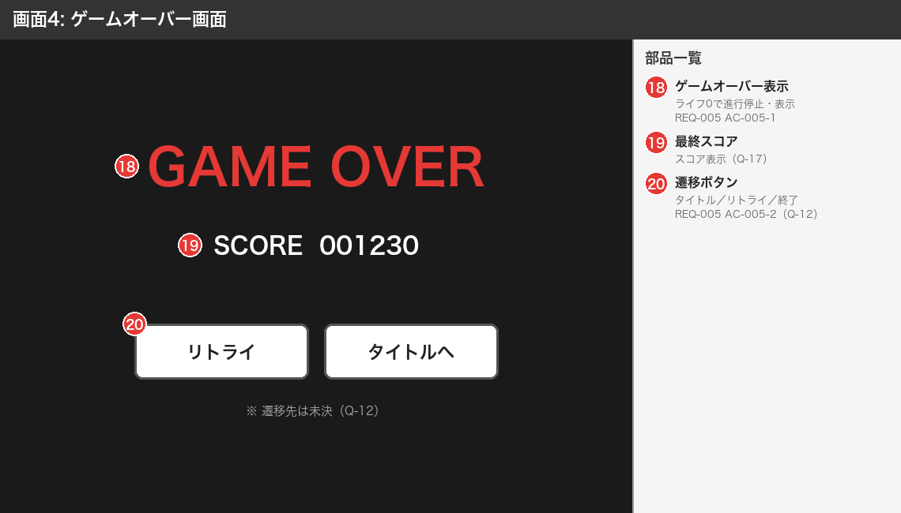

# 要求仕様書: フェイスランナー

- バージョン: v0.7
- チーム: 16
- 最終更新日: 2026-11-29
- ステータス: 草案 / レビュー中 / 承認済み

## 1. 背景と目的
（どんな人の、どんな困りごとを、画像処理・画像認識でどう解決するか）
- アプリ名: フェイスランナー（Q-21）
- 想定ユーザー: PCで気軽にゲームを遊びたい一般の利用者（学生など）（Q-01）。以下、本書の「利用者」はこの人を指す。

## 2. ユーザーストーリー
- US-01:  利用者として、難易度の選択をしてゲームをスタートしたい。なぜなら、熟練度にあった難易度のゲームをプレイすることで快適にプレイできるから。
- US-02:  利用者として、顔の動きでキャラクターを動かしたい。なぜなら顔がコントローラーだから。
- US-03:  利用者として、敵に当たったらプレイヤーのライフを減らしたい。なぜなら、ゲームオーバーをライフゼロで実現したいから。
- US-04:  （v0.6 で削除。中断機能をなくしたため（Q-27）。ID は欠番とする）
- US-05:  利用者として、途中でゲームを終了できるようにしたい。なぜなら、予定があるときにゲームを終了したいから。
- US-06:  利用者として、背景が自動でスクロールしてほしい。なぜなら、操作しなくてもゲームが進むことで緊張感が生まれるから。（Q-16 で追加。理由は案）
- US-07:  利用者として、敵が出現してほしい。なぜなら、避ける対象があることでゲームとして楽しめるから。（Q-16 で追加。理由は案）
- US-08:  利用者として、スコアを見たい。なぜなら、どれだけ長く生き残れたかを知りたいから。（Q-16 で追加。理由は案）
- US-09:  利用者として、ゲーム画面をカラーで見たい。なぜなら、キャラクターや敵を見分けやすいから。（Q-16 で追加。理由は案）

## 3. スコープ
### 対象
- 強制スクロール、敵出現、難易度選択、スコア表示、カラー表示
### 対象外
- スコアアタック、タイマー機能
- クリア条件（ゴール・ステージ終了）。ゲームはライフが0になるまで続くエンドレス形式とする（Q-19）
- 敵を倒す手段（攻撃）（Q-19）
- 利用者の操作によるゲームの中断・再開と、状態の保存（Q-27）

## 4. 画面（GUI）仕様
（画面スケッチの画像を docs/specs/ に置き、ここから参照する。画面の各部品に番号を付け、動作を書く）
> 画面スケッチは案。〈 〉や `Q-xx` を付けた部品は未決事項（8章）の決定後に確定させる。
> 画面スケッチ画像は v0.4 時点のまま。v0.6 の内容（画面3の削除、画面5の追加、⑫の削除、⑭の動作）はまだ反映していない。
> 中断機能の削除により、部品 ⑫・⑮・⑯・⑰・㉑・㉒ は欠番とする。

### 4.0 画面遷移（案）

### 4.1 画面1: タイトル／難易度選択画面

| No | 部品 | 動作 |
|----|------|------|
| ① | タイトル | アプリ名「フェイスランナー」を表示する |
| ② | 難易度ボタン | 「かんたん」「ふつう」「むずかしい」を表示する。矢印キーで選択する。REQ-001 AC-001-1/2 |
| ③ | 選択中ハイライト | 選択中の難易度を強調表示する。REQ-001 AC-001-2 |
| ④ | スタートボタン | 難易度が選択されているときのみ、Enter キーでゲームを開始する。カメラ映像を取得できれば画面2へ遷移し、取得できなければカメラエラーを表示する（4.6節）。デフォルト難易度は設けない。REQ-002 AC-002-1/2、REQ-003 AC-003-7 |
| ⑤ | 操作説明 | 難易度選択（矢印キー）・開始（Enter キー）の操作方法を表示する |

### 4.2 画面2: ゲーム画面（プレイ中）

| No | 部品 | 動作 |
|----|------|------|
| ⑥ | ライフ表示 | 残りライフ（初期値3）を表示し、敵との接触で更新する。REQ-004 AC-004-1/2 |
| ⑦ | スコア表示 | 経過時間を0.1秒単位で画面右上に表示する。REQ-010 |
| ⑧ | プレイヤーキャラクター | 顔の位置のずれの方向に応じて、上下左右に一定速度で移動する。画面外には出ない。REQ-003 AC-003-1/5 |
| ⑨ | 敵 | 画面右端のランダムな高さから出現して左へまっすぐ進み、プレイヤーと接触するとライフを1減らす。REQ-004 AC-004-2/3、REQ-009 |
| ⑩ | 背景（強制スクロール） | 背景を右から左へ、難易度に応じた速度で自動スクロールする。REQ-008 |
| ⑪ | カメラ映像 | カメラ映像を表示し、顔が検出されたときは検出枠を重ねる。顔未検出でゲームの進行を止めている間も映像を更新する。REQ-003 AC-003-6 |
| ⑬ | 終了キーの案内 | 終了キー（Q）を表示する。Q キーが押されたら画面5（終了確認）を表示する。REQ-007 AC-007-1 |
| ⑭ | 顔未検出の警告 | 映像を取得できていて、顔が1秒間連続で映像から検出されないときに表示し、ゲームの進行を自動で止める。顔が再び検出されたら警告を消し、自動で進行を再開する。終了確認ダイアログ表示中は、ダイアログを閉じるまで進行を止める。REQ-003 AC-003-3/8 |

### 4.3 画面3: （v0.6 で削除）
中断機能の削除（Q-27）により、中断中画面はなくなった。

### 4.4 画面4: ゲームオーバー画面

| No | 部品 | 動作 |
|----|------|------|
| ⑱ | ゲームオーバー表示 | ライフが0になったとき、ゲームの進行を止めて表示する。REQ-005 AC-005-1 |
| ⑲ | 最終スコア | 最終スコア（経過時間、0.1秒単位）を表示する。REQ-010 AC-010-4 |
| ⑳ | 遷移の選択肢 | 「リトライ」「タイトルに戻る」「アプリ終了」を表示し、矢印キーで選んで Enter キーで決定した遷移をする。REQ-005 AC-005-2 |

### 4.5 画面5: 終了確認ダイアログ
（画面スケッチは未作成）

| No | 部品 | 動作 |
|----|------|------|
| ㉓ | 確認メッセージ | ゲームを終了してタイトルに戻るかを尋ねる。表示中はゲームの進行を止める。REQ-007 AC-007-1 |
| ㉔ | はい | 矢印キーで選んで Enter キーで決定すると、タイトル（画面1）に戻る。REQ-007 AC-007-2 |
| ㉕ | いいえ | 矢印キーで選んで Enter キーで決定すると、ダイアログを閉じてゲーム画面（画面2）に戻る。REQ-007 AC-007-3 |

### 4.6 カメラエラーの表示
初回開始時・リトライ時にカメラ映像を取得できない場合や、プレイ中にカメラの切断などで映像を取得できなくなった場合は、カメラ映像を取得できないことを伝えるエラーダイアログを表示する。利用者がダイアログを閉じるとアプリを終了する。REQ-003 AC-003-7

## 5. 入出力ファイル仕様
> v0.6 時点では「案」。顔検出モデルはライブラリ（OpenCV）が確定してから決める。

| 種類 | 形式 | 説明 |
|------|------|------|
| 入力 | PNG または JPEG | テスト画像。顔検出の精度を確かめるための顔画像20枚（明るい・暗い × 近い・遠い の4条件 × 各5枚）を `data/test_images/faces/` に置く。AC-003-2 |
| 入力 | XML（OpenCV の Haar Cascade） | 顔検出モデル。OpenCV に付属する `haarcascade_frontalface_default.xml` をそのまま使う。REQ-003 |
| 入力 | JSON | 難易度設定。「かんたん」「ふつう」「むずかしい」ごとのゲームパラメータ（スクロール速度、敵の出現間隔）をまとめたもの。初期ライフは全難易度共通（3）のため含めない。例: `config/difficulty.json`。REQ-001 AC-001-3 |
| 入力 | —（ファイルなし） | カメラ映像。ファイルではなく、カメラからその場で読み込む。REQ-003 |
| 出力 | なし | 出力ファイルは作らない（スコアアタックは対象外、中断データの保存はなくした（Q-27）ため） |

## 6. 機能要求
> v0.6 で未決事項 Q-21〜32 の決定（9章）を反映した。〈 〉で囲んだ値・`Q-xx`（Q-33 以降）を参照している箇所は、決定後に確定させる。

### REQ-001: 難易度選択
- 説明: ゲーム開始前に、利用者が3段階の難易度から1つを選択できる。
- 対応US: US-01
- 受け入れ基準:
  - AC-001-1: ゲーム開始前の画面を表示しているとき、システムは難易度「かんたん」「ふつう」「むずかしい」を表示しなければならない。
  - AC-001-2: 利用者が矢印キーで難易度を選んだとき、システムは選択中の難易度が分かる表示をしなければならない。
  - AC-001-3: 難易度が選択されたとき、システムはその難易度に対応するスクロール速度と敵の出現間隔でゲームを開始しなければならない。各値は「ふつう」の値〈基準値（Q-33）〉を基準とし、「かんたん」はスクロール速度を0.7倍・出現間隔を1.3倍、「むずかしい」はスクロール速度を1.3倍・出現間隔を0.7倍とする。
- 優先度: Must

### REQ-002: ゲーム開始
- 説明: 難易度を選択したあと、利用者の操作でゲームを開始できる。
- 対応US: US-01
- 受け入れ基準:
  - AC-002-1: 難易度が選択された状態で利用者が Enter キーを押したとき、カメラ映像を取得できれば、システムはゲームを開始しなければならない。取得できない場合は AC-003-7 に従う。
  - AC-002-2: 難易度が選択されていない状態では、システムはゲームを開始してはならない。（デフォルト難易度は設けない）
- 優先度: Must

### REQ-003: 顔の動きによるキャラクター操作
- 説明: カメラ映像から利用者の顔を検出し、顔の動きに合わせてプレイヤーキャラクターを動かす。
- 対応US: US-02
- 受け入れ基準:
  - AC-003-1: ゲーム中にカメラ映像内で顔が検出されているとき、システムは顔の検出枠の中心がカメラ映像の中央から上下左右にずれた方向を判定し、ずれが映像の幅（左右方向）または高さ（上下方向）の10%を超えた方向へ、プレイヤーキャラクターを一定速度〈速度（Q-33）、全難易度共通〉で移動させなければならない。両軸のずれがともに10%以内のときは、その場に留まらなければならない。
    - 確認方法: カメラ映像上で、顔の中心を中央（両軸ともずれが10%以内）に置く試行と、中央から上・下・左・右のそれぞれに顔を動かす試行を1回ずつ行う。方向別の試行では、対象の軸でずれが10%を超え、もう一方の軸では10%以内になるようにする。キャラクターが画面端に達していない状態で確認し、中央では移動せず、方向別では顔を動かした方向にだけ移動すれば成功とする。顔を検出できたうえで、5回中5回成功すれば合格とする。
  - AC-003-2: `data/test_images/faces/` の顔画像20枚（明るい・暗い × 近い・遠い の4条件 × 各5枚）のうち、16枚以上で顔を正しく検出しなければならない。各画像で操作対象の顔の中心位置を事前に記録し、操作に使う検出枠がその位置を囲んでいれば成功とする。（各条件の具体的な基準は Q-34）
  - AC-003-3: カメラ映像を取得できていて顔が検出されない間は、顔操作によるキャラクターの移動を止めなければならない。顔が1秒間連続で検出されないときは、顔未検出の警告を表示し、背景スクロール、敵の出現・移動、衝突判定、スコアの加算を含むゲームの進行を止めなければならない。
  - AC-003-4: カメラ映像内に複数の顔があるとき、システムは検出枠の面積が最も大きい顔を操作に使わなければならない。
  - AC-003-5: システムはプレイヤーキャラクターを画面外に出してはならない。
  - AC-003-6: ゲーム中、システムはカメラ映像を画面に表示し、顔が検出されたときは検出枠を重ねなければならない。顔未検出でゲームの進行を止めている間も、カメラ映像の表示を更新しなければならない。
  - AC-003-7: 未接続やアクセス許可がないなどの理由で初回開始時・リトライ時にカメラ映像を取得できない場合、システムはゲームの進行を開始してはならない。プレイ中にカメラの切断などで映像を取得できなくなった場合は、その時点でゲームの進行を止めなければならない。どちらの場合もカメラ映像を取得できないことを伝えるエラーダイアログを表示し、利用者が閉じたらアプリを終了しなければならない。
  - AC-003-8: AC-003-3 で進行を止めているときに顔が再び検出されたら、システムは警告を消し、止めた時点の状態（ライフ・スコア・キャラクターと敵の位置）からゲームの進行を自動で再開しなければならない。終了確認ダイアログ表示中は、表示を閉じてゲームに戻るまで進行を止める（AC-007-1〜3）。
- 優先度: Must

### REQ-004: 敵との衝突によるライフ減少
- 説明: プレイヤーキャラクターが敵に当たると、プレイヤーのライフが減る。
- 対応US: US-03
- 受け入れ基準:
  - AC-004-1: ゲーム開始時、システムはプレイヤーのライフを3（全難易度共通）に設定し、画面に表示しなければならない。
  - AC-004-2: プレイヤーキャラクターと敵が接触したとき、システムはライフを1減らし、表示を更新しなければならない。
  - AC-004-3: 接触後の2秒間、システムはプレイヤーキャラクターを点滅表示し、敵と接触してもライフを減らしてはならない。
- 優先度: Must

### REQ-005: ライフゼロによるゲームオーバー
- 説明: ライフが0になったらゲームオーバーにする。
- 対応US: US-03
- 受け入れ基準:
  - AC-005-1: ライフが0になったとき、システムはゲームの進行を止め、ゲームオーバーであることを表示しなければならない。
  - AC-005-2: ゲームオーバー表示のあと、システムは「リトライ」「タイトルに戻る」「アプリ終了」を表示し、利用者が矢印キーで選んで Enter キーで決定した遷移をしなければならない。リトライでは、カメラ映像を取得できれば、同じ難易度でライフとスコアを初期状態に戻してゲームを開始する。取得できない場合は AC-003-7 に従う。
- 優先度: Must

### REQ-006: （v0.6 で削除）
- 中断機能をなくしたため削除した（Q-27）。ID は欠番とする。

### REQ-007: ゲームの途中終了
- 説明: ゲームの途中で、利用者の操作によりゲームを終了し、タイトルに戻れる。
- 対応US: US-05
- 受け入れ基準:
  - AC-007-1: ゲーム中に利用者が Q キーを押したとき、システムはゲームの進行を止め、終了確認ダイアログを表示しなければならない。
  - AC-007-2: 終了確認ダイアログで「はい」が選ばれたとき、システムはゲームを終了し、タイトル画面に戻らなければならない。
  - AC-007-3: 終了確認ダイアログで「いいえ」が選ばれたとき、システムはダイアログを閉じ、ダイアログを表示する前のゲーム状態から続けなければならない。顔未検出による停止中は、顔が再び検出されるまでゲームの進行を止める（AC-003-3/8）。
- 優先度: Should

### REQ-008: 強制スクロール
- 説明: ゲーム中、背景が自動でスクロールする。
- 対応US: US-06
- 受け入れ基準:
  - AC-008-1: ゲーム中、システムは背景を右から左へ、選択された難易度に対応する速度で自動スクロールしなければならない。
- 優先度: Must

### REQ-009: 敵の出現
- 説明: ゲーム中、敵が出現して移動する。
- 対応US: US-07
- 受け入れ基準:
  - AC-009-1: ゲーム中、システムは選択された難易度に対応する出現間隔で、画面右端のランダムな高さに敵を出現させなければならない。
  - AC-009-2: システムは敵を左へまっすぐ〈敵の移動速度（Q-33）〉で移動させ、画面左端から出た敵を消さなければならない。
- 優先度: Must

### REQ-010: スコア表示
- 説明: ゲームの経過時間をスコアとして表示する。
- 対応US: US-08
- 受け入れ基準:
  - AC-010-1: ゲーム開始時、システムはスコアを0.0にしなければならない。
  - AC-010-2: ゲーム中、システムは経過時間を0.1秒単位でスコアとして画面右上に表示しなければならない。
  - AC-010-3: 顔未検出で進行を止めている間（AC-003-3）と、終了確認ダイアログの表示中の時間を、システムはスコアに含めてはならない。
  - AC-010-4: ゲームオーバーのとき、システムは最終スコアを表示しなければならない。
- 優先度: Must

### REQ-011: カラー表示
- 説明: ゲーム画面をカラーで描画する。
- 対応US: US-09
- 受け入れ基準:
  - AC-011-1: システムはゲーム画面（背景・プレイヤーキャラクター・敵・ライフ表示・スコア表示）をカラーで描画しなければならない。
- 優先度: Must

## 7. 非機能要求
### NFR-001: フレームレート
- 説明: 顔の動きをなめらかにキャラクターへ反映するため、ゲーム画面を一定以上の頻度で更新する。
- 受け入れ基準:
  - ゲーム中（顔検出とカメラ映像の表示を含む）、システムはゲーム画面を15fps以上で更新しなければならない。
  - 測定方法: 1分間プレイし、ゲームループの実行回数を経過秒数で割った値をフレームレートとする。チーム全員のPCで測定し、すべてのPCで15fps以上であること。

## 8. 未決事項
| ID | 内容 | 選択肢 | 状態 |
|----|------|--------|------|
| Q-01 | アプリ名と、US中の〈利用者〉が具体的に誰か（想定ユーザー層）。「1. 背景と目的」も未記入 | — | 決定（9章）。アプリ名は Q-21 で決定 |
| Q-02 | 難易度の段階数・名称と、難易度で何が変わるか | 段階: 2 / 3 / それ以上。変わるもの: スクロール速度、敵の出現頻度、敵の速度、初期ライフ など | 決定（9章） |
| Q-03 | 難易度選択・ゲーム開始の操作方法 | キーボード / マウス（ボタン） / 顔の動き | 決定（9章） |
| Q-04 | 難易度にデフォルト値を設けるか（未選択のまま開始できるか） | 設ける / 設けない（必ず選択） | 決定（9章） |
| Q-05 | 「顔の動き」が何を指し、キャラクターがどう動くか | 動き: 顔の位置 / 顔の傾き / うなずき等。方向: 上下のみ / 左右のみ / 上下左右。方式: 顔の位置に比例 / 方向だけ判定して一定速度。あわせて、キャラクターが画面外に出られるか | 決定（9章） |
| Q-06 | 顔が検出されないときの動作 | その場で停止 / 自動で一時停止 / 警告表示のみ | 決定（9章）。v0.6 で Q-24 により内容を変更 |
| Q-07 | 複数の顔が映ったときにどの顔で操作するか | 最も大きい顔 / 最初に検出した顔 / 1人のときだけ操作可能 | 決定（9章） |
| Q-08 | 顔検出の精度の受け入れ基準と、テスト画像の内容（枚数・撮影条件） | 例: 10枚中8枚以上。条件: 明るさ、眼鏡・マスク、距離 など | 決定（9章） |
| Q-09 | 顔の動きからキャラクターが動くまでの遅延・フレームレートの基準（非機能要求にするか） | 例: 〈N〉fps 以上、遅延〈N〉ms 以下 | 決定（9章） |
| Q-10 | 初期ライフと、1回の接触で減るライフの量（難易度で変えるか） | — | 決定（9章） |
| Q-11 | 敵に当たった直後の扱い | 一定時間無敵 / 当たった敵が消える / 何もしない | 決定（9章） |
| Q-12 | ゲームオーバー後の遷移 | タイトル（難易度選択）に戻る / リトライ選択 / アプリ終了 | 決定（9章） |
| Q-13 | 「中断」の意味 | 一時停止して同じ起動中に再開できる / 状態を保存して次回起動時に再開できる | 取り消し（Q-27 で中断機能を削除） |
| Q-14 | 中断・再開の操作方法 | キー / 画面上のボタン / 顔のジェスチャ | 取り消し（Q-27 で中断機能を削除） |
| Q-15 | 「終了」の操作方法と終了後の遷移、確認ダイアログの有無、中断中にも終了できるか | 遷移: タイトルに戻る / アプリを閉じる。確認: あり / なし | 決定（9章）。「中断中も終了できる」は Q-27 で不要になった |
| Q-16 | スコープ「対象」の強制スクロール・敵出現・スコア表示・カラー表示に対応するユーザーストーリーがない。US を追加して REQ にするか | US追加 / 他REQの一部として扱う | 決定（9章） |
| Q-17 | スコアの計算方法（何で加点されるか）と表示位置。対象外の「スコアアタック」との違い | 加点: 経過距離 / 時間 / 敵を避けた数 など | 決定（9章） |
| Q-18 | 「カラー表示」が何を指すか | ゲーム画面をカラーで描画 / カメラ映像をカラーで表示 / その他 | 決定（9章） |
| Q-19 | クリア条件の有無（タイマーは対象外だが、ゴールやステージ終了はあるか）、敵を倒す手段（攻撃）の有無、カメラ映像をゲーム画面に表示するか、カメラが使えないときの動作 | — | 決定（9章） |
| Q-20 | 各REQの優先度（Must / Should / Could） | 現在は案として記載 | 決定（9章）。REQ-006 は削除 |
| Q-21 | アプリ名 | — | 決定（9章） |
| Q-22 | 3段階の難易度の名称と、各難易度のスクロール速度・敵の出現間隔の値 | 名称例: かんたん / ふつう / むずかしい | 決定（9章）。「ふつう」の基準値は Q-33 に分離 |
| Q-23 | 各操作に割り当てるキー（難易度選択、開始、続きから、中断、再開、終了、終了確認の はい/いいえ、ゲームオーバー後の選択） | 例: 矢印キー＋Enter、Esc、スペース | 決定（9章） |
| Q-24 | 顔未検出と判定するまでの時間（フレーム数）と、顔が再び検出されたときに自動で再開するか | 自動で再開 / 再開キーで再開 | 決定（9章） |
| Q-25 | 移動方向を判定する基準位置と不感帯、キャラクターの移動速度 | 基準位置: カメラ映像の中央 / ゲーム開始時の顔の位置 | 決定（9章）。速度の値は Q-33 に分離 |
| Q-26 | 敵に当たった後の無敵時間の長さ | 例: 1秒 / 2秒 | 決定（9章） |
| Q-27 | 中断データの保存の操作・タイミング、保存先、再開後にデータを消すか、データが壊れているときの動作 | 保存: 中断中に保存キー / 中断中にアプリを閉じたとき自動 | 決定（9章）。中断機能そのものを削除 |
| Q-28 | テスト画像のフォルダ名と、明るさ・距離の具体的な撮影条件（各条件の枚数） | — | 決定（9章）。各条件の具体的な基準は Q-34 に分離 |
| Q-29 | NFR-001（15fps以上）の測定方法と、基準とするPC | — | 決定（9章） |
| Q-30 | 追加した REQ-008〜011 の優先度 | Must / Should / Could | 決定（9章） |
| Q-31 | 強制スクロールの方向と、敵の出現位置・動き方 | 方向: 右→左 / 上→下。敵: 画面端から直進 など | 決定（9章）。敵の移動速度は Q-33 に分離 |
| Q-32 | スコア（経過時間）の単位と表示位置 | 単位: 秒 / 0.1秒。位置: 画面右上 など | 決定（9章） |
| Q-33 | ゲームの数値: 「ふつう」のスクロール速度と敵の出現間隔、キャラクターの移動速度、敵の移動速度（難易度で変えるか） | 試遊で決めて `difficulty.json` に書く / 要求仕様書に値を書く | 未決 |
| Q-34 | テスト画像の各条件の具体的な基準（「暗い」「遠い」とは何か）、誰の顔を撮るか、画像をリポジトリに入れてよいか | 例: 暗い＝部屋の照明を消す、遠い＝カメラから1.5m | 未決 |

## 9. 決定事項
| ID | 決定内容 | 理由 | 日付 |
|----|----------|------|------|
| Q-01 | 想定ユーザーは、PCで気軽にゲームを遊びたい一般の利用者（学生など）とする | | 2026-11-24 |
| Q-02 | 難易度は3段階とし、難易度で変わるものはスクロール速度と敵の出現頻度とする | | 2026-11-24 |
| Q-03 | 難易度選択・ゲーム開始はキーボードで操作する | | 2026-11-24 |
| Q-04 | 難易度のデフォルト値は設けない（必ず選択してから開始する） | | 2026-11-24 |
| Q-05 | 顔の位置を使い、上下左右のずれの方向だけを判定して、キャラクターを一定速度で移動させる。キャラクターは画面外に出られない | | 2026-11-24 |
| Q-06 | 顔が検出されないときは、警告を表示してゲームの進行を自動で止める（v0.6 で Q-24 により、再開は顔の再検出で自動に変更） | | 2026-11-24 |
| Q-07 | 複数の顔が映ったときは、最も大きい顔で操作する | | 2026-11-24 |
| Q-08 | 顔検出の基準は20枚中16枚以上とし、テスト画像は明るさと距離を変えて撮影する | | 2026-11-24 |
| Q-09 | フレームレートを非機能要求にし、15fps以上とする | | 2026-11-24 |
| Q-10 | 初期ライフは3、1回の接触で減るライフは1とし、全難易度で共通とする | | 2026-11-24 |
| Q-11 | 敵に当たった直後は一定時間無敵とし、その間キャラクターを点滅表示する | | 2026-11-24 |
| Q-12 | ゲームオーバー後は「リトライ」「タイトルに戻る」「アプリ終了」から選ぶ | | 2026-11-24 |
| Q-13 | （v0.6 で取り消し: Q-27）中断は、同じ起動中の一時停止に加えて、状態を保存して次回起動時に再開できるようにする | | 2026-11-24 |
| Q-14 | （v0.6 で取り消し: Q-27）中断・再開はキーで操作する | | 2026-11-24 |
| Q-15 | 終了は確認ダイアログを出してからタイトルに戻る（「中断中も終了できる」は v0.6 で中断機能の削除により不要） | | 2026-11-24 |
| Q-16 | 強制スクロール・敵出現・スコア表示・カラー表示のすべてに US と REQ を追加する（US-06〜09、REQ-008〜011） | | 2026-11-24 |
| Q-17 | スコアは経過時間とする | | 2026-11-24 |
| Q-18 | 「カラー表示」はゲーム画面をカラーで描画することとする | | 2026-11-24 |
| Q-19 | クリア条件なし（エンドレス）、攻撃なし、カメラ映像をゲーム画面に表示する、カメラが使えないときはエラーを表示して終了する | | 2026-11-24 |
| Q-20 | 優先度は REQ-001〜005 を Must、REQ-006・007 を Should とする（REQ-006 は v0.6 で削除） | | 2026-11-24 |
| Q-21 | アプリ名は「フェイスランナー」とする | | 2026-11-24 |
| Q-22 | 難易度の名称は「かんたん」「ふつう」「むずかしい」とする。値は「ふつう」を基準とし、「かんたん」はスクロール速度0.7倍・出現間隔1.3倍、「むずかしい」はスクロール速度1.3倍・出現間隔0.7倍とする | | 2026-11-24 |
| Q-23 | 矢印キーで選択、Enter キーで決定、Q キーで終了とする（終了確認の はい/いいえ、ゲームオーバー後の選択も矢印キーと Enter キー）。中断用の Esc キーは中断機能の削除により使わない | | 2026-11-24 |
| Q-24 | 顔が1秒間連続で検出されないとき、警告を表示してゲームの進行を止め、顔が再び検出されたら自動で再開する（当初は「再開キーで再開」を選んだが、中断機能の削除に伴い変更） | | 2026-11-24 |
| Q-25 | 基準位置はカメラ映像の中央、不感帯は映像の幅・高さの10%、キャラクターの移動速度は全難易度共通の固定値とする | | 2026-11-24 |
| Q-26 | 無敵時間は2秒とする | | 2026-11-24 |
| Q-27 | 中断機能（一時停止・再開・状態の保存）をすべて削除する。US-04 と REQ-006、画面3、中断データを削除し、ID は欠番とする | | 2026-11-24 |
| Q-28 | テスト画像は `data/test_images/faces/` に置き、明るい・暗い × 近い・遠い の4条件 × 各5枚とする | | 2026-11-24 |
| Q-29 | フレームレートは1分間プレイしてゲームループの実行回数÷経過秒数で測り、チーム全員のPCですべて15fps以上とする | | 2026-11-24 |
| Q-30 | REQ-008〜011 の優先度はすべて Must とする | | 2026-11-24 |
| Q-31 | 背景は右から左へスクロールし、敵は画面右端のランダムな高さから出現して左へまっすぐ進む | | 2026-11-24 |
| Q-32 | スコアは0.1秒単位で画面右上に表示する | | 2026-11-24 |

## 10. 変更履歴
| バージョン | 日付 | 変更内容 | レビュー者 |
|------------|------|----------|------------|
| v0.1 | | 初版 | |
| v0.2 | 2026-11-23 | 6章に US-01〜05 から REQ-001〜007 と受け入れ基準の案を追加。8章に未決事項 Q-01〜20 を追加 | |
| v0.3 | 2026-11-23 | 4章に画面スケッチ（画面遷移・画面1〜4）の画像参照と部品表（①〜⑳）を追加 | |
| v0.4 | 2026-11-23 | 5章に入出力ファイル仕様の案（入力: テスト画像 PNG/JPEG、顔検出モデル XML、難易度設定 JSON、カメラ映像。出力: なし）を追加 | |
| v0.5 | 2026-11-24 | Q-01〜20 の決定を9章に記録し、1〜7章に反映。US-06〜09・REQ-008〜011・NFR-001・画面5（終了確認）・部品㉑〜㉕・中断データ（JSON）を追加。決定で残った細部を Q-21〜32 として8章に追加 | |
| v0.6 | 2026-11-24 | Q-21〜32 の決定を9章に記録し、1〜7章に反映。Q-27 により中断機能を削除（US-04・REQ-006・画面3・部品⑫⑮⑯⑰㉑㉒・中断データを欠番／削除、Q-13・Q-14 を取り消し）。顔未検出時は自動停止・自動再開に変更（Q-06・Q-24）。残った細部を Q-33・Q-34 として8章に追加 | |
| v0.7 | 2026-11-29 | 仕様レビューの指摘1・3を反映。顔検出と方向操作の合否判定を明記し、カメラ映像の取得失敗と顔未検出それぞれの表示・停止・再開・終了の条件を明確化 | |
