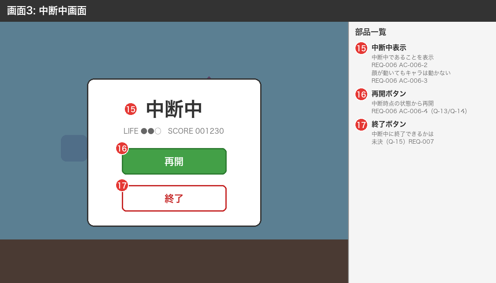

# 要求仕様書: 〈アプリ名〉

- バージョン: v0.4
- チーム:
- 最終更新日: 2026-11-23
- ステータス: 草案 / レビュー中 / 承認済み

## 1. 背景と目的
（どんな人の、どんな困りごとを、画像処理・画像認識でどう解決するか）
## 2. ユーザーストーリー
- US-01:  〈利用者〉として、難易度の選択をしてゲームをスタートしたい。なぜなら、熟練度にあった難易度のゲームをプレイすることで快適にプレイできるから。
- US-02:  〈利用者〉として、顔の動きでキャラクターを動かしたい。なぜなら顔がコントローラーだから。
- US-03:  〈利用者〉として、敵に当たったらプレイヤーのライフを減らしたい。なぜなら、ゲームオーバーをライフゼロで実現したいから。
- US-04:  〈利用者〉として、途中でゲームを中断できるようにしたい。なぜなら、予定があるときにゲームを中断したいから。
- US-05:  〈利用者〉として、途中でゲームを終了できるようにしたい。なぜなら、予定があるときにゲームを終了したいから。

## 3. スコープ
### 対象
- 強制スクロール、敵出現、難易度選択、スコア表示、カラー表示
### 対象外
- スコアアタック、タイマー機能

## 4. 画面（GUI）仕様
（画面スケッチの画像を docs/specs/ に置き、ここから参照する。画面の各部品に番号を付け、動作を書く）
> 画面スケッチは案。〈 〉や `Q-xx` を付けた部品は未決事項（8章）の決定後に確定させる。

### 4.0 画面遷移（案）

### 4.1 画面1: タイトル／難易度選択画面

| No | 部品 | 動作 |
|----|------|------|
| ① | タイトル | アプリ名を表示する（Q-01） |
| ② | 難易度ボタン | 選択可能な難易度を表示する。段階数・名称は案（Q-02）。REQ-001 AC-001-1 |
| ③ | 選択中ハイライト | 選択中の難易度を強調表示する。REQ-001 AC-001-2 |
| ④ | スタートボタン | 難易度が選択されているときのみゲームを開始し、画面2へ遷移する。REQ-002 AC-002-1/2（Q-04） |
| ⑤ | 操作説明 | 難易度選択・開始の操作方法を表示する（Q-03） |

### 4.2 画面2: ゲーム画面（プレイ中）

| No | 部品 | 動作 |
|----|------|------|
| ⑥ | ライフ表示 | 残りライフを表示し、敵との接触で更新する（Q-10）。REQ-004 AC-004-1/2 |
| ⑦ | スコア表示 | スコアを表示する。計算方法・表示位置は未決（Q-17） |
| ⑧ | プレイヤーキャラクター | 顔の動きに応じて移動する（Q-05）。REQ-003 AC-003-1 |
| ⑨ | 敵 | 出現・移動し、プレイヤーと接触するとライフを減らす（Q-11）。REQ-004 AC-004-2/3 |
| ⑩ | 背景（強制スクロール） | 背景を自動でスクロールする（Q-16） |
| ⑪ | カメラ映像 | カメラ映像と顔の検出枠を表示する。表示するかは未決（Q-19） |
| ⑫ | 中断ボタン | ゲームの進行を止め、画面3へ遷移する（Q-14）。REQ-006 AC-006-1 |
| ⑬ | 終了ボタン | ゲームを終了し、終了後の遷移をする（Q-15）。REQ-007 AC-007-1 |
| ⑭ | 顔未検出の警告 | 顔が検出されないときに表示する（Q-06）。REQ-003 AC-003-3 |

### 4.3 画面3: 中断中画面

| No | 部品 | 動作 |
|----|------|------|
| ⑮ | 中断中表示 | 中断中であることを表示する。中断中は顔が動いてもキャラクターを動かさない。REQ-006 AC-006-2/3 |
| ⑯ | 再開ボタン | 中断した時点の状態から再開し、画面2へ戻る（Q-13/Q-14）。REQ-006 AC-006-4 |
| ⑰ | 終了ボタン | ゲームを終了する。中断中に終了できるかは未決（Q-15）。REQ-007 AC-007-1 |

### 4.4 画面4: ゲームオーバー画面

| No | 部品 | 動作 |
|----|------|------|
| ⑱ | ゲームオーバー表示 | ライフが0になったとき、ゲームの進行を止めて表示する。REQ-005 AC-005-1 |
| ⑲ | 最終スコア | 最終スコアを表示する（Q-17） |
| ⑳ | 遷移ボタン | タイトル／リトライ／アプリ終了のいずれかへ遷移する（Q-12）。REQ-005 AC-005-2 |

## 5. 入出力ファイル仕様
> v0.4 時点では「案」。顔検出モデルはライブラリ（OpenCV）が確定してから決める。中断データの要否は Q-13 の結果で決める。

| 種類 | 形式 | 説明 |
|------|------|------|
| 入力 | PNG または JPEG | テスト画像。顔検出の精度を確かめるための顔画像を `data/test_images/〈フォルダ（Q-08）〉/` に置く。AC-003-2 |
| 入力 | XML（OpenCV の Haar Cascade） | 顔検出モデル。OpenCV に付属する `haarcascade_frontalface_default.xml` をそのまま使う。REQ-003 |
| 入力 | JSON | 難易度設定。難易度ごとのゲームパラメータ（スクロール速度、敵の出現間隔、初期ライフなど）をまとめたもの。例: `config/difficulty.json`（Q-02, Q-10）。REQ-001 AC-001-3 |
| 入力 | —（ファイルなし） | カメラ映像。ファイルではなく、カメラからその場で読み込む。REQ-003 |
| 出力 | なし | 出力ファイルは作らない（スコアアタックは対象外のため）。Q-13 で「状態を保存して次回起動時に再開」を選んだ場合は、中断データ（JSON）を出力に追加する |

## 6. 機能要求
> v0.2 時点ではすべて「案」。〈 〉で囲んだ値・`Q-xx` を参照している箇所は未決事項（8章）で決定後に確定させる。
> 優先度は未決（Q-20）のため、各REQには「案」として記載する。

### REQ-001: 難易度選択
- 説明: ゲーム開始前に、利用者が複数の難易度から1つを選択できる。
- 対応US: US-01
- 受け入れ基準:
  - AC-001-1: ゲーム開始前の画面を表示しているとき、システムは選択可能な難易度〈難易度の一覧（Q-02）〉を表示しなければならない。
  - AC-001-2: 利用者が〈選択操作（Q-03）〉で難易度を選んだとき、システムは選択中の難易度が分かる表示をしなければならない。
  - AC-001-3: 難易度が選択されたとき、システムはその難易度に対応する〈ゲームパラメータ（Q-02）〉でゲームを開始しなければならない。
- 優先度: 案 Must（Q-20）

### REQ-002: ゲーム開始
- 説明: 難易度を選択したあと、利用者の操作でゲームを開始できる。
- 対応US: US-01
- 受け入れ基準:
  - AC-002-1: 難易度が選択された状態で利用者が〈開始操作（Q-03）〉を行ったとき、システムはゲームを開始しなければならない。
  - AC-002-2: 難易度が選択されていない状態では、システムはゲームを開始してはならない。（デフォルト難易度の有無は Q-04）
- 優先度: 案 Must（Q-20）

### REQ-003: 顔の動きによるキャラクター操作
- 説明: カメラ映像から利用者の顔を検出し、顔の動きに合わせてプレイヤーキャラクターを動かす。
- 対応US: US-02
- 受け入れ基準:
  - AC-003-1: ゲーム中にカメラ映像内で顔が検出されているとき、システムは〈顔の動き（Q-05）〉に応じて、プレイヤーキャラクターを〈移動方向・移動方式（Q-05）〉で移動させなければならない。
  - AC-003-2: data/test_images/〈フォルダ（Q-08）〉の顔画像〈N〉枚のうち〈M〉枚以上で、システムは顔を検出しなければならない。（枚数・基準は Q-08）
  - AC-003-3: 顔が検出されなくなったとき、システムは〈未検出時の動作（Q-06）〉をしなければならない。
  - AC-003-4: カメラ映像内に複数の顔があるとき、システムは〈操作に使う顔の選び方（Q-07）〉に従って1つの顔を操作に使わなければならない。
- 優先度: 案 Must（Q-20）

### REQ-004: 敵との衝突によるライフ減少
- 説明: プレイヤーキャラクターが敵に当たると、プレイヤーのライフが減る。
- 対応US: US-03
- 受け入れ基準:
  - AC-004-1: ゲーム開始時、システムはプレイヤーのライフを〈初期ライフ（Q-10）〉に設定し、画面に表示しなければならない。
  - AC-004-2: プレイヤーキャラクターと敵が接触したとき、システムはライフを〈減少量（Q-10）〉だけ減らし、表示を更新しなければならない。
  - AC-004-3: 接触後の〈無敵時間・敵の消滅などの扱い（Q-11）〉の間、同じ接触でライフが連続して減ってはならない。
- 優先度: 案 Must（Q-20）

### REQ-005: ライフゼロによるゲームオーバー
- 説明: ライフが0になったらゲームオーバーにする。
- 対応US: US-03
- 受け入れ基準:
  - AC-005-1: ライフが0になったとき、システムはゲームの進行を止め、ゲームオーバーであることを表示しなければならない。
  - AC-005-2: ゲームオーバー表示のあと、システムは〈その後の遷移（Q-12）〉をしなければならない。
- 優先度: 案 Must（Q-20）

### REQ-006: ゲームの中断
- 説明: ゲームの途中で、利用者の操作によりゲームを中断できる。
- 対応US: US-04
- 受け入れ基準:
  - AC-006-1: ゲーム中に利用者が〈中断操作（Q-14）〉を行ったとき、システムはスクロール・敵の移動・衝突判定を含むゲームの進行を止めなければならない。
  - AC-006-2: 中断中であるとき、システムは中断中であることを画面に表示しなければならない。
  - AC-006-3: 中断中に顔が動いても、システムはプレイヤーキャラクターを移動させてはならない。
  - AC-006-4: 中断中に利用者が〈再開操作（Q-14）〉を行ったとき、システムは中断した時点の状態（ライフ・スコア・キャラクターと敵の位置）からゲームを再開しなければならない。（「中断」の意味そのものは Q-13）
- 優先度: 案 Should（Q-20）

### REQ-007: ゲームの途中終了
- 説明: ゲームの途中で、利用者の操作によりゲームを終了できる。
- 対応US: US-05
- 受け入れ基準:
  - AC-007-1: ゲーム中（中断中を含むかは Q-15）に利用者が〈終了操作（Q-15）〉を行ったとき、システムはゲームを終了し、〈終了後の遷移（Q-15）〉をしなければならない。
- 優先度: 案 Should（Q-20）

## 7. 非機能要求
### NFR-001: 〈要求名〉（例: 処理速度、対応OS）
- 説明:
- 受け入れ基準:

## 8. 未決事項
| ID | 内容 | 選択肢 | 状態 |
|----|------|--------|------|
| Q-01 | アプリ名と、US中の〈利用者〉が具体的に誰か（想定ユーザー層）。「1. 背景と目的」も未記入 | — | 未決 |
| Q-02 | 難易度の段階数・名称と、難易度で何が変わるか | 段階: 2 / 3 / それ以上。変わるもの: スクロール速度、敵の出現頻度、敵の速度、初期ライフ など | 未決 |
| Q-03 | 難易度選択・ゲーム開始の操作方法 | キーボード / マウス（ボタン） / 顔の動き | 未決 |
| Q-04 | 難易度にデフォルト値を設けるか（未選択のまま開始できるか） | 設ける / 設けない（必ず選択） | 未決 |
| Q-05 | 「顔の動き」が何を指し、キャラクターがどう動くか | 動き: 顔の位置 / 顔の傾き / うなずき等。方向: 上下のみ / 左右のみ / 上下左右。方式: 顔の位置に比例 / 方向だけ判定して一定速度。あわせて、キャラクターが画面外に出られるか | 未決 |
| Q-06 | 顔が検出されないときの動作 | その場で停止 / 自動で一時停止 / 警告表示のみ | 未決 |
| Q-07 | 複数の顔が映ったときにどの顔で操作するか | 最も大きい顔 / 最初に検出した顔 / 1人のときだけ操作可能 | 未決 |
| Q-08 | 顔検出の精度の受け入れ基準と、テスト画像の内容（枚数・撮影条件） | 例: 10枚中8枚以上。条件: 明るさ、眼鏡・マスク、距離 など | 未決 |
| Q-09 | 顔の動きからキャラクターが動くまでの遅延・フレームレートの基準（非機能要求にするか） | 例: 〈N〉fps 以上、遅延〈N〉ms 以下 | 未決 |
| Q-10 | 初期ライフと、1回の接触で減るライフの量（難易度で変えるか） | — | 未決 |
| Q-11 | 敵に当たった直後の扱い | 一定時間無敵 / 当たった敵が消える / 何もしない | 未決 |
| Q-12 | ゲームオーバー後の遷移 | タイトル（難易度選択）に戻る / リトライ選択 / アプリ終了 | 未決 |
| Q-13 | 「中断」の意味 | 一時停止して同じ起動中に再開できる / 状態を保存して次回起動時に再開できる | 未決 |
| Q-14 | 中断・再開の操作方法 | キー / 画面上のボタン / 顔のジェスチャ | 未決 |
| Q-15 | 「終了」の操作方法と終了後の遷移、確認ダイアログの有無、中断中にも終了できるか | 遷移: タイトルに戻る / アプリを閉じる。確認: あり / なし | 未決 |
| Q-16 | スコープ「対象」の強制スクロール・敵出現・スコア表示・カラー表示に対応するユーザーストーリーがない。US を追加して REQ にするか | US追加 / 他REQの一部として扱う | 未決 |
| Q-17 | スコアの計算方法（何で加点されるか）と表示位置。対象外の「スコアアタック」との違い | 加点: 経過距離 / 時間 / 敵を避けた数 など | 未決 |
| Q-18 | 「カラー表示」が何を指すか | ゲーム画面をカラーで描画 / カメラ映像をカラーで表示 / その他 | 未決 |
| Q-19 | クリア条件の有無（タイマーは対象外だが、ゴールやステージ終了はあるか）、敵を倒す手段（攻撃）の有無、カメラ映像をゲーム画面に表示するか、カメラが使えないときの動作 | — | 未決 |
| Q-20 | 各REQの優先度（Must / Should / Could） | 現在は案として記載 | 未決 |

## 9. 決定事項
| ID | 決定内容 | 理由 | 日付 |
|----|----------|------|------|

## 10. 変更履歴
| バージョン | 日付 | 変更内容 | レビュー者 |
|------------|------|----------|------------|
| v0.1 | | 初版 | |
| v0.2 | 2026-11-23 | 6章に US-01〜05 から REQ-001〜007 と受け入れ基準の案を追加。8章に未決事項 Q-01〜20 を追加 | |
| v0.3 | 2026-11-23 | 4章に画面スケッチ（画面遷移・画面1〜4）の画像参照と部品表（①〜⑳）を追加 | |
| v0.4 | 2026-11-23 | 5章に入出力ファイル仕様の案（入力: テスト画像 PNG/JPEG、顔検出モデル XML、難易度設定 JSON、カメラ映像。出力: なし）を追加 | |
