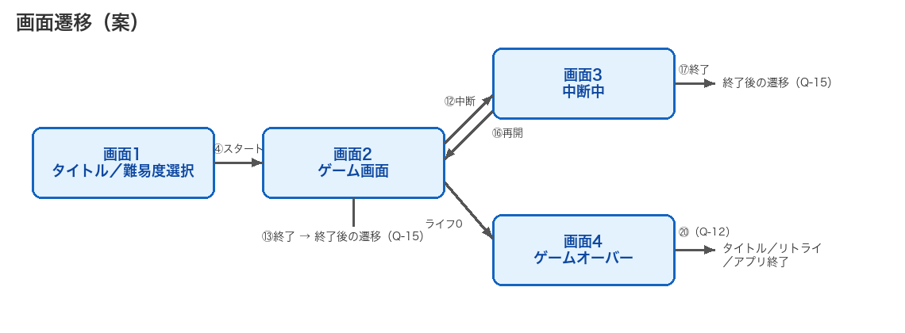
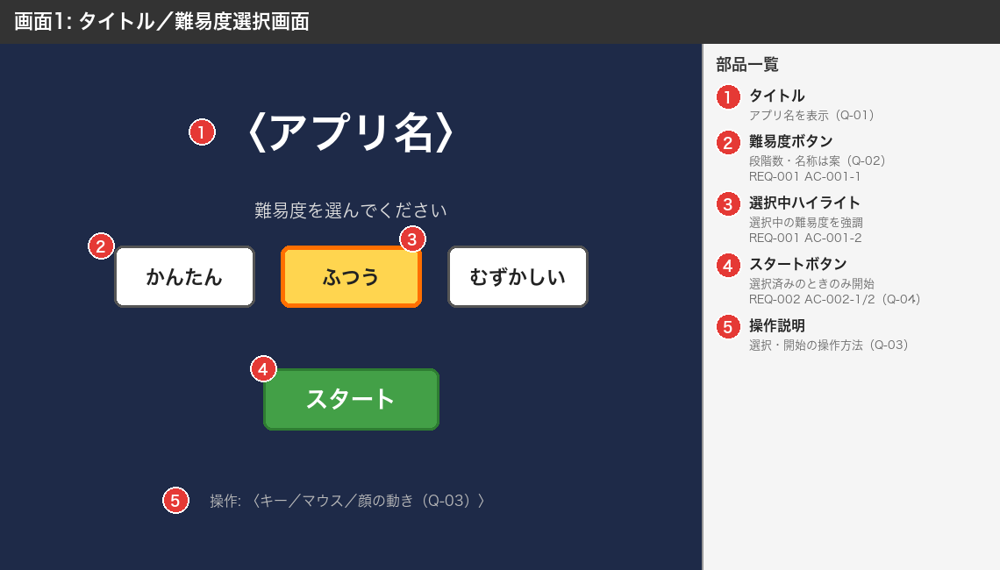

# 要求仕様書: 〈アプリ名〉

- バージョン: v0.5
- チーム:
- 最終更新日: 2026-11-24
- ステータス: 草案 / レビュー中 / 承認済み

## 1. 背景と目的
（どんな人の、どんな困りごとを、画像処理・画像認識でどう解決するか）
- 想定ユーザー: PCで気軽にゲームを遊びたい一般の利用者（学生など）（Q-01）。以下、本書の「利用者」はこの人を指す。
- アプリ名は未決（Q-21）。

## 2. ユーザーストーリー
- US-01:  利用者として、難易度の選択をしてゲームをスタートしたい。なぜなら、熟練度にあった難易度のゲームをプレイすることで快適にプレイできるから。
- US-02:  利用者として、顔の動きでキャラクターを動かしたい。なぜなら顔がコントローラーだから。
- US-03:  利用者として、敵に当たったらプレイヤーのライフを減らしたい。なぜなら、ゲームオーバーをライフゼロで実現したいから。
- US-04:  利用者として、途中でゲームを中断できるようにしたい。なぜなら、予定があるときにゲームを中断したいから。
- US-05:  利用者として、途中でゲームを終了できるようにしたい。なぜなら、予定があるときにゲームを終了したいから。
- US-06:  利用者として、背景が自動でスクロールしてほしい。なぜなら、操作しなくてもゲームが進むことで緊張感が生まれるから。（Q-16 で追加。理由は案）
- US-07:  利用者として、敵が出現してほしい。なぜなら、避ける対象があることでゲームとして楽しめるから。（Q-16 で追加。理由は案）
- US-08:  利用者として、スコアを見たい。なぜなら、どれだけ長く生き残れたかを知りたいから。（Q-16 で追加。理由は案）
- US-09:  利用者として、ゲーム画面をカラーで見たい。なぜなら、キャラクターや敵を見分けやすいから。（Q-16 で追加。理由は案）

## 3. スコープ
### 対象
- 強制スクロール、敵出現、難易度選択、スコア表示、カラー表示
### 対象外
- スコアアタック、タイマー機能
- クリア条件（ゴール・ステージ終了）。ゲームはライフが0になるまで続くエンドレス形式とする（Q-19）
- 敵を倒す手段（攻撃）（Q-19）

## 4. 画面（GUI）仕様
（画面スケッチの画像を docs/specs/ に置き、ここから参照する。画面の各部品に番号を付け、動作を書く）
> 画面スケッチは案。〈 〉や `Q-xx` を付けた部品は未決事項（8章）の決定後に確定させる。
> v0.5 で追加した部品（㉑〜㉕）と画面5、顔未検出時の画面2→画面3の遷移は、画面スケッチ画像にまだ反映していない。

### 4.0 画面遷移（案）

### 4.1 画面1: タイトル／難易度選択画面

| No | 部品 | 動作 |
|----|------|------|
| ① | タイトル | アプリ名を表示する（Q-21） |
| ② | 難易度ボタン | 3段階の難易度を表示する。名称は未決（Q-22）。キーボードで選択する。REQ-001 AC-001-1 |
| ③ | 選択中ハイライト | 選択中の難易度を強調表示する。REQ-001 AC-001-2 |
| ④ | スタートボタン | 難易度が選択されているときのみ、キーボード操作でゲームを開始し、画面2へ遷移する。デフォルト難易度は設けない。REQ-002 AC-002-1/2 |
| ⑤ | 操作説明 | 難易度選択・開始に使うキーを表示する（キーの割り当ては Q-23） |
| ㉑ | 続きからボタン | 中断データがあるときのみ表示する。選ばれたら保存した状態からゲームを再開し、画面2へ遷移する。REQ-006 AC-006-6 |

### 4.2 画面2: ゲーム画面（プレイ中）

| No | 部品 | 動作 |
|----|------|------|
| ⑥ | ライフ表示 | 残りライフ（初期値3）を表示し、敵との接触で更新する。REQ-004 AC-004-1/2 |
| ⑦ | スコア表示 | 経過時間をスコアとして表示する。表示位置・単位は未決（Q-32）。REQ-010 |
| ⑧ | プレイヤーキャラクター | 顔の位置のずれの方向に応じて、上下左右に一定速度で移動する。画面外には出ない。REQ-003 AC-003-1/5 |
| ⑨ | 敵 | 出現・移動し、プレイヤーと接触するとライフを1減らす。REQ-004 AC-004-2/3、REQ-009 |
| ⑩ | 背景（強制スクロール） | 背景を難易度に応じた速度で自動スクロールする。REQ-008 |
| ⑪ | カメラ映像 | カメラ映像と顔の検出枠を表示する。REQ-003 AC-003-6 |
| ⑫ | 中断キーの案内 | 中断に使うキーを表示する。中断キーが押されたらゲームの進行を止め、画面3へ遷移する（キーは Q-23）。REQ-006 AC-006-1 |
| ⑬ | 終了キーの案内 | 終了に使うキーを表示する。終了キーが押されたら画面5（終了確認）を表示する（キーは Q-23）。REQ-007 AC-007-1 |
| ⑭ | 顔未検出の警告 | 顔が検出されないときに表示し、ゲームを自動で一時停止して画面3へ遷移する（Q-24）。REQ-003 AC-003-3 |

### 4.3 画面3: 中断中画面

| No | 部品 | 動作 |
|----|------|------|
| ⑮ | 中断中表示 | 中断中であることを表示する。中断中は顔が動いてもキャラクターを動かさない。REQ-006 AC-006-2/3 |
| ⑯ | 再開キーの案内 | 再開に使うキーを表示する。再開キーが押されたら中断した時点の状態から再開し、画面2へ戻る（キーは Q-23）。REQ-006 AC-006-4 |
| ⑰ | 終了キーの案内 | 終了に使うキーを表示する。中断中も終了できる。終了キーが押されたら画面5（終了確認）を表示する。REQ-007 AC-007-1 |
| ㉒ | 中断データの保存 | 中断データをファイルに保存する。操作・タイミングは未決（Q-27）。REQ-006 AC-006-5 |

### 4.4 画面4: ゲームオーバー画面

| No | 部品 | 動作 |
|----|------|------|
| ⑱ | ゲームオーバー表示 | ライフが0になったとき、ゲームの進行を止めて表示する。REQ-005 AC-005-1 |
| ⑲ | 最終スコア | 最終スコア（経過時間）を表示する。REQ-010 AC-010-4 |
| ⑳ | 遷移の選択肢 | 「リトライ」「タイトルに戻る」「アプリ終了」を表示し、キーボードで選ばれた遷移をする。REQ-005 AC-005-2 |

### 4.5 画面5: 終了確認ダイアログ
（画面スケッチは未作成）

| No | 部品 | 動作 |
|----|------|------|
| ㉓ | 確認メッセージ | ゲームを終了してタイトルに戻るかを尋ねる。表示中はゲームの進行を止める。REQ-007 AC-007-1 |
| ㉔ | はい | タイトル（画面1）に戻る。REQ-007 AC-007-2 |
| ㉕ | いいえ | ダイアログを閉じ、表示前の画面（画面2または画面3）に戻る。REQ-007 AC-007-3 |

## 5. 入出力ファイル仕様
> v0.5 時点では「案」。顔検出モデルはライブラリ（OpenCV）が確定してから決める。

| 種類 | 形式 | 説明 |
|------|------|------|
| 入力 | PNG または JPEG | テスト画像。顔検出の精度を確かめるための顔画像20枚を、明るさと距離を変えて撮影し、`data/test_images/〈フォルダ（Q-28）〉/` に置く。AC-003-2 |
| 入力 | XML（OpenCV の Haar Cascade） | 顔検出モデル。OpenCV に付属する `haarcascade_frontalface_default.xml` をそのまま使う。REQ-003 |
| 入力 | JSON | 難易度設定。3段階の難易度ごとのゲームパラメータ（スクロール速度、敵の出現間隔）をまとめたもの。初期ライフは全難易度共通（3）のため含めない。例: `config/difficulty.json`（値は Q-22）。REQ-001 AC-001-3 |
| 入力 | —（ファイルなし） | カメラ映像。ファイルではなく、カメラからその場で読み込む。REQ-003 |
| 入出力 | JSON | 中断データ。中断時の状態（難易度、ライフ、スコア、プレイヤーキャラクターと敵の位置）を保存し、次回起動時に「続きから」で読み込む。保存先（例: `save/suspend.json`）・保存タイミング・再開後の扱いは Q-27。REQ-006 AC-006-5/6 |

## 6. 機能要求
> v0.5 で未決事項 Q-01〜20 の決定（9章）を反映した。〈 〉で囲んだ値・`Q-xx`（Q-21 以降）を参照している箇所は、決定後に確定させる。

### REQ-001: 難易度選択
- 説明: ゲーム開始前に、利用者が3段階の難易度から1つを選択できる。
- 対応US: US-01
- 受け入れ基準:
  - AC-001-1: ゲーム開始前の画面を表示しているとき、システムは3段階の難易度〈名称（Q-22）〉を表示しなければならない。
  - AC-001-2: 利用者がキーボード〈選択キー（Q-23）〉で難易度を選んだとき、システムは選択中の難易度が分かる表示をしなければならない。
  - AC-001-3: 難易度が選択されたとき、システムはその難易度に対応するスクロール速度と敵の出現間隔〈値（Q-22）〉でゲームを開始しなければならない。
- 優先度: Must

### REQ-002: ゲーム開始
- 説明: 難易度を選択したあと、利用者の操作でゲームを開始できる。
- 対応US: US-01
- 受け入れ基準:
  - AC-002-1: 難易度が選択された状態で利用者がキーボード〈開始キー（Q-23）〉を押したとき、システムはゲームを開始しなければならない。
  - AC-002-2: 難易度が選択されていない状態では、システムはゲームを開始してはならない。（デフォルト難易度は設けない）
- 優先度: Must

### REQ-003: 顔の動きによるキャラクター操作
- 説明: カメラ映像から利用者の顔を検出し、顔の動きに合わせてプレイヤーキャラクターを動かす。
- 対応US: US-02
- 受け入れ基準:
  - AC-003-1: ゲーム中にカメラ映像内で顔が検出されているとき、システムは顔の位置が〈基準位置（Q-25）〉から〈不感帯（Q-25）〉を超えてずれた方向（上下左右）を判定し、プレイヤーキャラクターをその方向へ一定速度〈速度（Q-25）〉で移動させなければならない。
  - AC-003-2: data/test_images/〈フォルダ（Q-28）〉の顔画像（明るさと距離を変えて撮影した20枚）のうち16枚以上で、システムは顔を検出しなければならない。
  - AC-003-3: 顔が〈判定時間（Q-24）〉連続で検出されないとき、システムは顔未検出の警告を表示し、ゲームを一時停止（REQ-006 と同じ中断状態）しなければならない。（顔が再び検出されたときに自動で再開するかは Q-24）
  - AC-003-4: カメラ映像内に複数の顔があるとき、システムは検出枠の面積が最も大きい顔を操作に使わなければならない。
  - AC-003-5: システムはプレイヤーキャラクターを画面外に出してはならない。
  - AC-003-6: ゲーム中、システムはカメラ映像と顔の検出枠を画面に表示しなければならない。
  - AC-003-7: カメラを利用できないとき、システムはエラーメッセージを表示し、アプリを終了しなければならない。
- 優先度: Must

### REQ-004: 敵との衝突によるライフ減少
- 説明: プレイヤーキャラクターが敵に当たると、プレイヤーのライフが減る。
- 対応US: US-03
- 受け入れ基準:
  - AC-004-1: ゲーム開始時、システムはプレイヤーのライフを3（全難易度共通）に設定し、画面に表示しなければならない。
  - AC-004-2: プレイヤーキャラクターと敵が接触したとき、システムはライフを1減らし、表示を更新しなければならない。
  - AC-004-3: 接触後の〈無敵時間（Q-26）〉の間、システムはプレイヤーキャラクターを点滅表示し、敵と接触してもライフを減らしてはならない。
- 優先度: Must

### REQ-005: ライフゼロによるゲームオーバー
- 説明: ライフが0になったらゲームオーバーにする。
- 対応US: US-03
- 受け入れ基準:
  - AC-005-1: ライフが0になったとき、システムはゲームの進行を止め、ゲームオーバーであることを表示しなければならない。
  - AC-005-2: ゲームオーバー表示のあと、システムは「リトライ」「タイトルに戻る」「アプリ終了」を表示し、キーボード〈キー（Q-23）〉で選ばれた遷移をしなければならない。リトライでは、同じ難易度でライフとスコアを初期状態に戻してゲームを開始する。
- 優先度: Must

### REQ-006: ゲームの中断
- 説明: ゲームの途中で、利用者の操作によりゲームを中断できる。中断した状態は、同じ起動中に再開できるほか、保存して次回起動時に再開することもできる。
- 対応US: US-04
- 受け入れ基準:
  - AC-006-1: ゲーム中に利用者が〈中断キー（Q-23）〉を押したとき、システムはスクロール・敵の移動・衝突判定を含むゲームの進行を止めなければならない。
  - AC-006-2: 中断中であるとき、システムは中断中であることを画面に表示しなければならない。
  - AC-006-3: 中断中に顔が動いても、システムはプレイヤーキャラクターを移動させてはならない。
  - AC-006-4: 中断中に利用者が〈再開キー（Q-23）〉を押したとき、システムは中断した時点の状態（ライフ・スコア・キャラクターと敵の位置）からゲームを再開しなければならない。
  - AC-006-5: 中断中に〈保存の操作・タイミング（Q-27）〉のとき、システムは中断データ（難易度・ライフ・スコア・キャラクターと敵の位置）をファイルに保存しなければならない。
  - AC-006-6: 中断データがある状態でアプリを起動したとき、システムはタイトル画面に「続きから」を表示し、選ばれたら保存した状態からゲームを再開しなければならない。
- 優先度: Should

### REQ-007: ゲームの途中終了
- 説明: ゲームの途中（中断中を含む）で、利用者の操作によりゲームを終了し、タイトルに戻れる。
- 対応US: US-05
- 受け入れ基準:
  - AC-007-1: ゲーム中または中断中に利用者が〈終了キー（Q-23）〉を押したとき、システムはゲームの進行を止め、終了確認ダイアログを表示しなければならない。
  - AC-007-2: 終了確認ダイアログで「はい」が選ばれたとき、システムはゲームを終了し、タイトル画面に戻らなければならない。
  - AC-007-3: 終了確認ダイアログで「いいえ」が選ばれたとき、システムはダイアログを閉じ、表示前の状態（ゲーム中または中断中）に戻らなければならない。
- 優先度: Should

### REQ-008: 強制スクロール
- 説明: ゲーム中、背景が自動でスクロールする。
- 対応US: US-06
- 受け入れ基準:
  - AC-008-1: ゲーム中、システムは背景を〈スクロール方向（Q-31）〉へ、選択された難易度に対応する速度で自動スクロールしなければならない。
- 優先度: 案 Must（Q-30）

### REQ-009: 敵の出現
- 説明: ゲーム中、敵が出現して移動する。
- 対応US: US-07
- 受け入れ基準:
  - AC-009-1: ゲーム中、システムは選択された難易度に対応する出現間隔で敵を出現させなければならない。
  - AC-009-2: システムは敵を〈出現位置・動き方（Q-31）〉で移動させなければならない。
- 優先度: 案 Must（Q-30）

### REQ-010: スコア表示
- 説明: ゲームの経過時間をスコアとして表示する。
- 対応US: US-08
- 受け入れ基準:
  - AC-010-1: ゲーム開始時、システムはスコアを0にしなければならない。
  - AC-010-2: ゲーム中、システムは経過時間〈単位（Q-32）〉をスコアとして〈表示位置（Q-32）〉に表示しなければならない。
  - AC-010-3: 中断中と終了確認ダイアログの表示中の時間を、システムはスコアに含めてはならない。
  - AC-010-4: ゲームオーバーのとき、システムは最終スコアを表示しなければならない。
- 優先度: 案 Must（Q-30）

### REQ-011: カラー表示
- 説明: ゲーム画面をカラーで描画する。
- 対応US: US-09
- 受け入れ基準:
  - AC-011-1: システムはゲーム画面（背景・プレイヤーキャラクター・敵・ライフ表示・スコア表示）をカラーで描画しなければならない。
- 優先度: 案 Must（Q-30）

## 7. 非機能要求
### NFR-001: フレームレート
- 説明: 顔の動きをなめらかにキャラクターへ反映するため、ゲーム画面を一定以上の頻度で更新する。
- 受け入れ基準:
  - ゲーム中（顔検出とカメラ映像の表示を含む）、システムはゲーム画面を15fps以上で更新しなければならない。（測定方法・基準とするPCは Q-29）

## 8. 未決事項
| ID | 内容 | 選択肢 | 状態 |
|----|------|--------|------|
| Q-01 | アプリ名と、US中の〈利用者〉が具体的に誰か（想定ユーザー層）。「1. 背景と目的」も未記入 | — | 決定（9章）。アプリ名は Q-21 に分離 |
| Q-02 | 難易度の段階数・名称と、難易度で何が変わるか | 段階: 2 / 3 / それ以上。変わるもの: スクロール速度、敵の出現頻度、敵の速度、初期ライフ など | 決定（9章）。名称・値は Q-22 に分離 |
| Q-03 | 難易度選択・ゲーム開始の操作方法 | キーボード / マウス（ボタン） / 顔の動き | 決定（9章） |
| Q-04 | 難易度にデフォルト値を設けるか（未選択のまま開始できるか） | 設ける / 設けない（必ず選択） | 決定（9章） |
| Q-05 | 「顔の動き」が何を指し、キャラクターがどう動くか | 動き: 顔の位置 / 顔の傾き / うなずき等。方向: 上下のみ / 左右のみ / 上下左右。方式: 顔の位置に比例 / 方向だけ判定して一定速度。あわせて、キャラクターが画面外に出られるか | 決定（9章）。数値は Q-25 に分離 |
| Q-06 | 顔が検出されないときの動作 | その場で停止 / 自動で一時停止 / 警告表示のみ | 決定（9章）。詳細は Q-24 に分離 |
| Q-07 | 複数の顔が映ったときにどの顔で操作するか | 最も大きい顔 / 最初に検出した顔 / 1人のときだけ操作可能 | 決定（9章） |
| Q-08 | 顔検出の精度の受け入れ基準と、テスト画像の内容（枚数・撮影条件） | 例: 10枚中8枚以上。条件: 明るさ、眼鏡・マスク、距離 など | 決定（9章）。フォルダ名・撮影条件の具体値は Q-28 に分離 |
| Q-09 | 顔の動きからキャラクターが動くまでの遅延・フレームレートの基準（非機能要求にするか） | 例: 〈N〉fps 以上、遅延〈N〉ms 以下 | 決定（9章）。測定方法は Q-29 に分離 |
| Q-10 | 初期ライフと、1回の接触で減るライフの量（難易度で変えるか） | — | 決定（9章） |
| Q-11 | 敵に当たった直後の扱い | 一定時間無敵 / 当たった敵が消える / 何もしない | 決定（9章）。無敵時間は Q-26 に分離 |
| Q-12 | ゲームオーバー後の遷移 | タイトル（難易度選択）に戻る / リトライ選択 / アプリ終了 | 決定（9章） |
| Q-13 | 「中断」の意味 | 一時停止して同じ起動中に再開できる / 状態を保存して次回起動時に再開できる | 決定（9章）。保存の詳細は Q-27 に分離 |
| Q-14 | 中断・再開の操作方法 | キー / 画面上のボタン / 顔のジェスチャ | 決定（9章）。キーの割り当ては Q-23 に分離 |
| Q-15 | 「終了」の操作方法と終了後の遷移、確認ダイアログの有無、中断中にも終了できるか | 遷移: タイトルに戻る / アプリを閉じる。確認: あり / なし | 決定（9章）。キーの割り当ては Q-23 に分離 |
| Q-16 | スコープ「対象」の強制スクロール・敵出現・スコア表示・カラー表示に対応するユーザーストーリーがない。US を追加して REQ にするか | US追加 / 他REQの一部として扱う | 決定（9章） |
| Q-17 | スコアの計算方法（何で加点されるか）と表示位置。対象外の「スコアアタック」との違い | 加点: 経過距離 / 時間 / 敵を避けた数 など | 決定（9章）。表示位置・単位は Q-32 に分離 |
| Q-18 | 「カラー表示」が何を指すか | ゲーム画面をカラーで描画 / カメラ映像をカラーで表示 / その他 | 決定（9章） |
| Q-19 | クリア条件の有無（タイマーは対象外だが、ゴールやステージ終了はあるか）、敵を倒す手段（攻撃）の有無、カメラ映像をゲーム画面に表示するか、カメラが使えないときの動作 | — | 決定（9章） |
| Q-20 | 各REQの優先度（Must / Should / Could） | 現在は案として記載 | 決定（9章）。追加した REQ-008〜011 は Q-30 に分離 |
| Q-21 | アプリ名 | — | 未決 |
| Q-22 | 3段階の難易度の名称と、各難易度のスクロール速度・敵の出現間隔の値 | 名称例: かんたん / ふつう / むずかしい | 未決 |
| Q-23 | 各操作に割り当てるキー（難易度選択、開始、続きから、中断、再開、終了、終了確認の はい/いいえ、ゲームオーバー後の選択） | 例: 矢印キー＋Enter、Esc、スペース | 未決 |
| Q-24 | 顔未検出と判定するまでの時間（フレーム数）と、顔が再び検出されたときに自動で再開するか | 自動で再開 / 再開キーで再開 | 未決 |
| Q-25 | 移動方向を判定する基準位置と不感帯、キャラクターの移動速度 | 基準位置: カメラ映像の中央 / ゲーム開始時の顔の位置 | 未決 |
| Q-26 | 敵に当たった後の無敵時間の長さ | 例: 1秒 / 2秒 | 未決 |
| Q-27 | 中断データの保存の操作・タイミング、保存先、再開後にデータを消すか、データが壊れているときの動作 | 保存: 中断中に保存キー / 中断中にアプリを閉じたとき自動 | 未決 |
| Q-28 | テスト画像のフォルダ名と、明るさ・距離の具体的な撮影条件（各条件の枚数） | — | 未決 |
| Q-29 | NFR-001（15fps以上）の測定方法と、基準とするPC | — | 未決 |
| Q-30 | 追加した REQ-008〜011 の優先度 | Must / Should / Could | 未決 |
| Q-31 | 強制スクロールの方向と、敵の出現位置・動き方 | 方向: 右→左 / 上→下。敵: 画面端から直進 など | 未決 |
| Q-32 | スコア（経過時間）の単位と表示位置 | 単位: 秒 / 0.1秒。位置: 画面右上 など | 未決 |

## 9. 決定事項
| ID | 決定内容 | 理由 | 日付 |
|----|----------|------|------|
| Q-01 | 想定ユーザーは、PCで気軽にゲームを遊びたい一般の利用者（学生など）とする | | 2026-11-24 |
| Q-02 | 難易度は3段階とし、難易度で変わるものはスクロール速度と敵の出現頻度とする | | 2026-11-24 |
| Q-03 | 難易度選択・ゲーム開始はキーボードで操作する | | 2026-11-24 |
| Q-04 | 難易度のデフォルト値は設けない（必ず選択してから開始する） | | 2026-11-24 |
| Q-05 | 顔の位置を使い、上下左右のずれの方向だけを判定して、キャラクターを一定速度で移動させる。キャラクターは画面外に出られない | | 2026-11-24 |
| Q-06 | 顔が検出されないときは、警告を表示してゲームを自動で一時停止する | | 2026-11-24 |
| Q-07 | 複数の顔が映ったときは、最も大きい顔で操作する | | 2026-11-24 |
| Q-08 | 顔検出の基準は20枚中16枚以上とし、テスト画像は明るさと距離を変えて撮影する | | 2026-11-24 |
| Q-09 | フレームレートを非機能要求にし、15fps以上とする | | 2026-11-24 |
| Q-10 | 初期ライフは3、1回の接触で減るライフは1とし、全難易度で共通とする | | 2026-11-24 |
| Q-11 | 敵に当たった直後は一定時間無敵とし、その間キャラクターを点滅表示する | | 2026-11-24 |
| Q-12 | ゲームオーバー後は「リトライ」「タイトルに戻る」「アプリ終了」から選ぶ | | 2026-11-24 |
| Q-13 | 中断は、同じ起動中の一時停止に加えて、状態を保存して次回起動時に再開できるようにする | | 2026-11-24 |
| Q-14 | 中断・再開はキーで操作する | | 2026-11-24 |
| Q-15 | 終了は確認ダイアログを出してからタイトルに戻る。中断中も終了できる | | 2026-11-24 |
| Q-16 | 強制スクロール・敵出現・スコア表示・カラー表示のすべてに US と REQ を追加する（US-06〜09、REQ-008〜011） | | 2026-11-24 |
| Q-17 | スコアは経過時間とする | | 2026-11-24 |
| Q-18 | 「カラー表示」はゲーム画面をカラーで描画することとする | | 2026-11-24 |
| Q-19 | クリア条件なし（エンドレス）、攻撃なし、カメラ映像をゲーム画面に表示する、カメラが使えないときはエラーを表示して終了する | | 2026-11-24 |
| Q-20 | 優先度は REQ-001〜005 を Must、REQ-006・007 を Should とする | | 2026-11-24 |

## 10. 変更履歴
| バージョン | 日付 | 変更内容 | レビュー者 |
|------------|------|----------|------------|
| v0.1 | | 初版 | |
| v0.2 | 2026-11-23 | 6章に US-01〜05 から REQ-001〜007 と受け入れ基準の案を追加。8章に未決事項 Q-01〜20 を追加 | |
| v0.3 | 2026-11-23 | 4章に画面スケッチ（画面遷移・画面1〜4）の画像参照と部品表（①〜⑳）を追加 | |
| v0.4 | 2026-11-23 | 5章に入出力ファイル仕様の案（入力: テスト画像 PNG/JPEG、顔検出モデル XML、難易度設定 JSON、カメラ映像。出力: なし）を追加 | |
| v0.5 | 2026-11-24 | Q-01〜20 の決定を9章に記録し、1〜7章に反映。US-06〜09・REQ-008〜011・NFR-001・画面5（終了確認）・部品㉑〜㉕・中断データ（JSON）を追加。決定で残った細部を Q-21〜32 として8章に追加 | |
